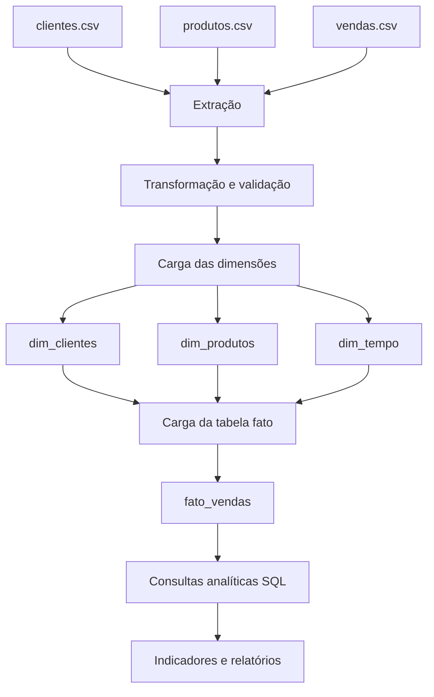

# Arquitetura do Projeto 02 — Data Warehouse

## 1. Visão geral

Este projeto implementa um Data Warehouse para uma empresa fictícia, utilizando dados de clientes, produtos e vendas.

O objetivo é construir um processo de ETL (Extract, Transform, Load), responsável por extrair dados de arquivos CSV, realizar validações e transformações com Python e Pandas e armazenar os resultados em um banco de dados PostgreSQL.

A solução utiliza modelagem dimensional no formato estrela, permitindo a execução de consultas analíticas para apoiar a análise de vendas e a geração de indicadores de negócio.

## 2. Objetivos técnicos

- Desenvolver um processo ETL utilizando Python.
- Extrair dados de diferentes arquivos CSV.
- Validar a qualidade e a consistência dos dados.
- Identificar registros duplicados e valores ausentes.
- Validar relacionamentos entre clientes, produtos e vendas.
- Construir dimensões e uma tabela fato.
- Implementar integridade referencial no PostgreSQL.
- Desenvolver consultas SQL analíticas.
- Criar testes automatizados com Pytest.

## 3. Tecnologias utilizadas

| Tecnologia | Aplicação |
|---|---|
| Python | Desenvolvimento do processo ETL |
| Pandas | Manipulação e transformação dos dados |
| PostgreSQL | Armazenamento do Data Warehouse |
| SQL | Criação de tabelas e consultas analíticas |
| SQLAlchemy | Conexão entre Python e PostgreSQL |
| Docker | Execução do ambiente PostgreSQL |
| Pytest | Testes automatizados |
| Git | Controle de versão |
| GitHub | Hospedagem do projeto |

## 4. Arquitetura do processo ETL

O processo está dividido em três etapas principais:

### 4.1 Extração (Extract)

Os dados são obtidos de três arquivos CSV:

- `clientes.csv`: informações dos clientes.
- `produtos.csv`: informações dos produtos.
- `vendas.csv`: registros das vendas.

O módulo `src/extract.py` utiliza Pandas para carregar os arquivos e disponibilizar os dados como DataFrames.

### 4.2 Transformação (Transform)

O módulo `src/transform.py` executa as regras de validação e transformação.

As principais operações são:

- Identificação de valores ausentes.
- Verificação de IDs duplicados.
- Validação de preços e custos dos produtos.
- Validação de quantidades e valores unitários das vendas.
- Verificação da existência de clientes e produtos relacionados às vendas.
- Conversão das colunas de datas.
- Cálculo do valor total de cada venda.

O cálculo do valor total utiliza:

`valor_total = quantidade × valor_unitario`

Essa etapa garante que os dados estejam consistentes antes da carga no banco de dados.

### 4.3 Carga (Load)

A carga é realizada nos módulos:

- `src/load_dimensions.py`
- `src/load_fact.py`

Primeiro, são carregadas as dimensões. Em seguida, os registros são inseridos na tabela fato, utilizando as chaves substitutas das dimensões.

O PostgreSQL utiliza o comando `ON CONFLICT DO NOTHING` para evitar a inserção de registros com identificadores já existentes.

## 5. Diagrama da arquitetura



## 6. Modelagem dimensional

O Data Warehouse utiliza o modelo estrela (Star Schema).

Esse modelo organiza os dados em tabelas de dimensão e uma tabela fato central.

### 6.1 Dimensão de clientes

Tabela: `dw_vendas.dim_clientes`

Armazena informações descritivas dos clientes:

- `sk_cliente`: chave substituta.
- `cliente_id`: identificador original do cliente.
- `nome`: nome do cliente.
- `cidade`: cidade.
- `estado`: unidade federativa.
- `data_cadastro`: data de cadastro.

### 6.2 Dimensão de produtos

Tabela: `dw_vendas.dim_produtos`

Armazena informações dos produtos:

- `sk_produto`: chave substituta.
- `produto_id`: identificador original do produto.
- `nome_produto`: nome do produto.
- `categoria`: categoria.
- `preco_unitario`: preço de venda.
- `custo_unitario`: custo do produto.

### 6.3 Dimensão de tempo

Tabela: `dw_vendas.dim_tempo`

Armazena informações temporais:

- `sk_tempo`: chave substituta.
- `data`: data completa.
- `dia`: dia do mês.
- `mes`: mês.
- `trimestre`: trimestre.
- `ano`: ano.
- `dia_semana`: dia da semana.

Essa dimensão permite analisar as vendas por períodos diferentes.

### 6.4 Tabela fato de vendas

Tabela: `dw_vendas.fato_vendas`

Armazena os eventos de venda e suas medidas quantitativas:

- `sk_venda`: chave substituta da venda.
- `venda_id`: identificador original da venda.
- `sk_cliente`: referência à dimensão de clientes.
- `sk_produto`: referência à dimensão de produtos.
- `sk_tempo`: referência à dimensão de tempo.
- `quantidade`: unidades vendidas.
- `valor_unitario`: valor de cada unidade.
- `valor_total`: valor total da venda.

A tabela fato concentra as medidas utilizadas nas análises.

## 7. Relacionamentos do modelo

A tabela fato se relaciona com as três dimensões por meio de chaves estrangeiras:

- `fato_vendas.sk_cliente` → `dim_clientes.sk_cliente`
- `fato_vendas.sk_produto` → `dim_produtos.sk_produto`
- `fato_vendas.sk_tempo` → `dim_tempo.sk_tempo`

Esses relacionamentos garantem a integridade referencial dos registros.

## 8. Organização do projeto

```text
02-data-warehouse/
│
├── dados/
│   ├── clientes.csv
│   ├── produtos.csv
│   └── vendas.csv
│
├── docs/
│   └── arquitetura.md
│
├── sql/
│   ├── 01_create_dimensions.sql
│   ├── 02_create_fact_table.sql
│   ├── 03_analytics_queries.sql
│
│
├── src/
│   ├── __init__.py
│   ├── extract.py
│   ├── transform.py
│   ├── database.py
│   ├── load_dimensions.py
│   ├── load_fact.py
│   └── pipeline.py
│
├── tests/
│   ├── test_transform.py
│   └── test_pipeline.py
│
└── README.md
```

## 9. Resultados das análises

Com os dados utilizados no projeto, foram obtidos os seguintes indicadores:

| Indicador | Resultado |
|---|---:|
| Total de vendas | 15 |
| Unidades vendidas | 25 |
| Faturamento total | R$ 16.870,00 |
| Ticket médio | R$ 1.124,67 |
| Clientes cadastrados | 10 |
| Produtos cadastrados | 10 |

Foram desenvolvidas consultas SQL para analisar:

- Indicadores gerais de vendas.
- Faturamento por categoria.
- Faturamento por cliente.
- Desempenho por produto.
- Faturamento por mês.
- Faturamento por cidade.

## 10. Testes automatizados

O projeto utiliza Pytest para verificar o comportamento das funções de transformação e a execução do pipeline.

Os testes contemplam:

- Dados válidos.
- Valores ausentes.
- IDs duplicados.
- Preços e custos inválidos.
- Quantidades inválidas.
- Valores unitários inválidos.
- Relacionamentos inconsistentes.
- Conversão de datas.
- Cálculo do valor total.
- Integração entre as etapas do pipeline.

**Resultado atual: 17 testes aprovados.**

O teste do pipeline utiliza mocks para simular as funções de extração, transformação e carga, sem executar operações reais no banco de dados.

## 11. Execução do projeto

Com o ambiente virtual ativado e o PostgreSQL disponível, a partir da pasta `02-data-warehouse`, execute:

```bash
python -m src.pipeline
```

Para executar os testes:

```bash
python -m pytest -v
```

## 12. Considerações finais

O projeto demonstra a construção de um processo de Engenharia de Dados utilizando ferramentas amplamente empregadas no desenvolvimento de soluções de integração e análise de dados.

A implementação permite compreender o funcionamento de processos ETL, validação de dados, modelagem dimensional, armazenamento em banco de dados relacional e consultas analíticas.

O desenvolvimento também proporciona experiência prática com Python, Pandas, PostgreSQL, SQL, Docker, Git e testes automatizados.
